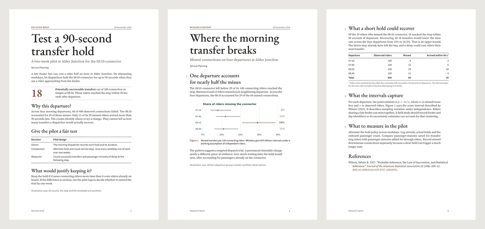
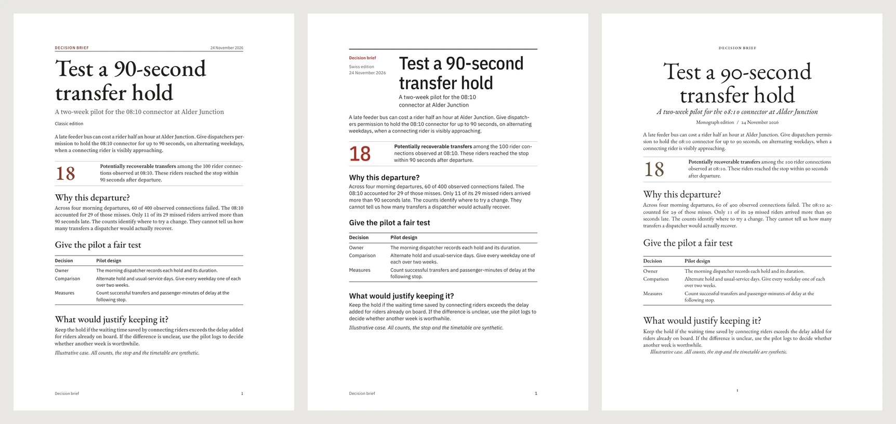

# Folio Reports

Write the finding in Markdown. Give the person reading it a PDF they can take into a meeting, annotate, or print. Folio supplies the typography, figure captions, tables, and page furniture. You own the text and the LaTeX in each project.

[Open the one-page decision brief](examples/decision-brief.pdf) · [Read the two-page research report](examples/research-report.pdf) · [Explore the component specimen](examples/component-specimen.pdf)



## Choose a starting point

| If your reader needs to… | Start with |
|---|---|
| Approve a change, understand its size, and know who acts next | **Brief.** An editorial headline, a prominent metric, and a short action table. |
| Inspect a result, follow the method, and judge its limits | **Research.** Numbered sections, vector figures, equations, and a bibliography. |
| Find a component and copy a working example | **Specimen.** A six-page pilot report with scorecards, charts, a comparison, a workflow, methods, and an appendix. |

The brief and research examples use the same synthetic transit observations. The brief proposes a 90-second hold. The report shows why a particular departure warrants a trial and what the counts can establish.

## Make your first report

Install [Pandoc](https://pandoc.org/installing.html) and [Tectonic](https://tectonic-typesetting.github.io/). With Python 3.12 or newer and uv, install Folio directly from GitHub.

```sh
uv tool install git+https://github.com/EssenceSentry/folio-reports.git
folio-reports new brief my-brief --title "Autumn service review" --author "Planning team"
folio-reports build my-brief
```

Open `my-brief/report.pdf` for a proof of the title and byline. Write below the metadata in `my-brief/report.md` and rebuild. To explore a finished example first, run `folio-reports new brief worked-example`. Tectonic downloads its TeX packages on the first build.

## Choose a visual style

Read the same brief three ways. **Classic** uses a Garamond headline over Source Serif text. **Swiss** puts the byline in a left column and sets the body in IBM Plex Sans. **Monograph** centers its opening and uses Garamond, indented paragraphs and a quiet page number.



[All ten styles at reading size](examples/style-lookbook.pdf) · [Masthead gallery](examples/style-previews.webp)

```sh
folio-reports styles
folio-reports new research my-study --style gazette
folio-reports build my-study --style blueprint -o blueprint-proof.pdf
```

The preview uses the same manuscript and leaves the project's saved style intact. Save a choice in `folio.yaml`. Each generated project includes editable copies of all ten designs.

## Choose a component

Create a worked example with `folio-reports new specimen my-components`. Its Markdown shows how to write a decision callout, compare two options, and place a chart beside the exact estimates and bounds. In the appendix, three changes in evening visits share one axis, so readers can see which intervals cross zero. The chart and labels stay sharp at any zoom. [Component reference](docs/components.md) · [Editable specimen](src/folio_reports/templates/specimen/report.md)

## Make it yours

- Change the title, subtitle, authors and date at the top of `report.md`. The body accepts Markdown tables, math, footnotes, citations, local figures, and raw LaTeX.
- Set margins, paper size and Pandoc options in `folio.yaml`. Edit the selected file in `styles/` for its title treatment and accent color, or `style.tex` for shared typography.
- Give a designer editable LaTeX with `folio-reports build my-brief -o my-brief/manuscript.tex`. Keep figures beside the source when sharing it.
- Build a generated project directly with `pandoc --defaults=folio.yaml report.md -o report.pdf` from its directory.

[Authoring guide](docs/getting-started.md) · [Template sources](src/folio_reports/templates) · [Development](DEVELOPMENT.md)
