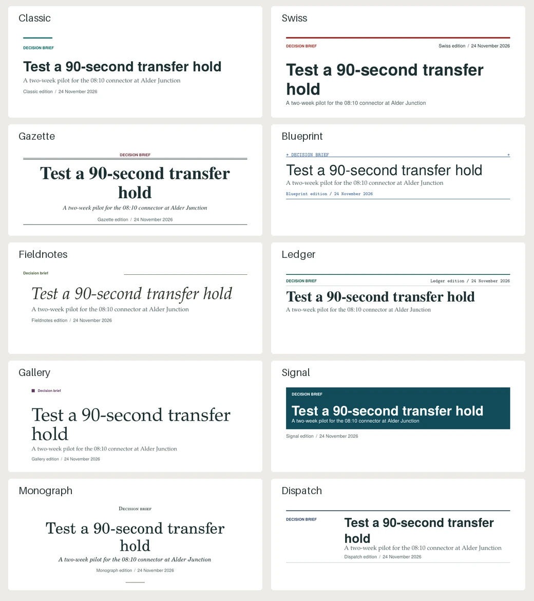

# Folio Reports

Write the finding in Markdown. Give the person reading it a PDF they can take into a meeting, annotate, or print. Folio supplies the typography, figure captions, tables, and page furniture. You own the text and the LaTeX in each project.

**[Compare ten styles on the same brief](examples/style-lookbook.pdf)** · **[Open the six-page component specimen](examples/component-specimen.pdf)**

[Decision brief](examples/decision-brief.pdf) · [Research report](examples/research-report.pdf)



## Choose a starting point

| If your reader needs to… | Start with |
|---|---|
| Approve a change, understand its size, and know who acts next | **Brief.** A compact sans-serif headline, a prominent metric, and a short action table. |
| Inspect a result, follow the method, and judge its limits | **Research.** Numbered sections, vector figures, equations, and a bibliography. |
| Find a component and copy a working example | **Specimen.** A six-page pilot report with scorecards, charts, a comparison, a workflow, methods, and an appendix. |

The brief and research examples use the same synthetic transit observations. The brief proposes a 90-second hold. The report shows why a particular departure warrants a trial and what the counts can establish.

## Make your first report

Install [Pandoc](https://pandoc.org/installing.html) and [Tectonic](https://tectonic-typesetting.github.io/), then install the CLI from this checkout with Python 3.12 or newer.

```sh
uv tool install --editable .
folio-reports new brief my-brief
folio-reports build my-brief
```

Open `my-brief/report.pdf`. Edit `my-brief/report.md` and run the build again. For the longer format, use `folio-reports new research my-study`. Tectonic downloads its TeX packages on the first build.

## Choose a visual style

```sh
folio-reports styles
folio-reports new research my-study --style gazette
folio-reports build my-study --style blueprint -o blueprint-proof.pdf
```

The preview uses the same manuscript and leaves the project's saved style intact. Save a choice in `folio.yaml`. Each generated project includes editable copies of all ten designs.

## Choose a component

Create a worked example with `folio-reports new specimen my-components`. Its Markdown shows how to write a decision callout, plot a range, compare two options, set a timeline or lay out an appendix. The PDF keeps numbers and labels selectable and draws the charts as vectors. [Component reference](docs/components.md) · [Editable specimen](src/folio_reports/templates/specimen/report.md)

## Make it yours

- Change the title, subtitle, authors and date at the top of `report.md`. The body accepts Markdown tables, math, footnotes, citations, local figures, and raw LaTeX.
- Set margins, paper size and Pandoc options in `folio.yaml`. Edit the selected file in `styles/` for its title treatment and accent color, or `style.tex` for shared typography.
- Give a designer editable LaTeX with `folio-reports build my-brief -o my-brief/manuscript.tex`. Keep figures beside the source when sharing it.
- Build a generated project directly with `pandoc --defaults=folio.yaml report.md -o report.pdf` from its directory.

[Authoring guide](docs/getting-started.md) · [Template sources](src/folio_reports/templates) · [Development](DEVELOPMENT.md)
