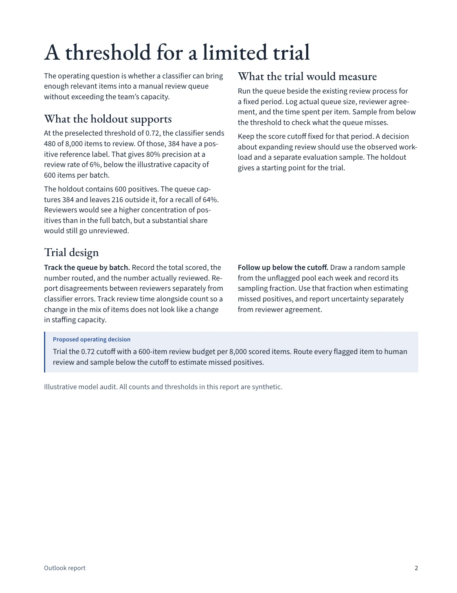
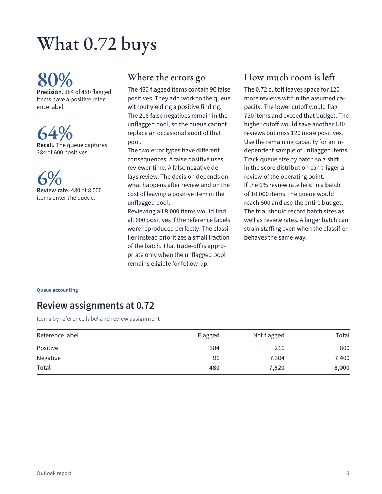
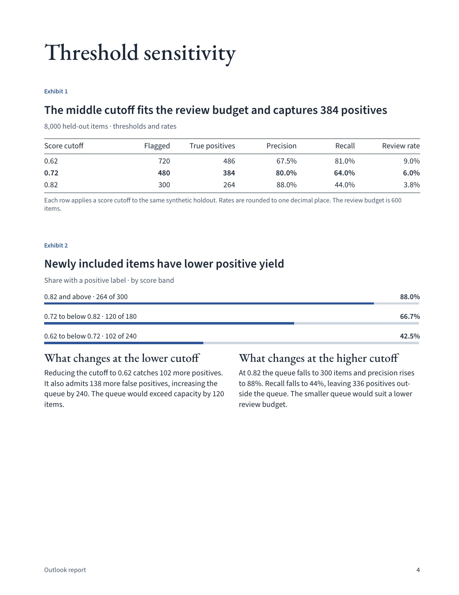
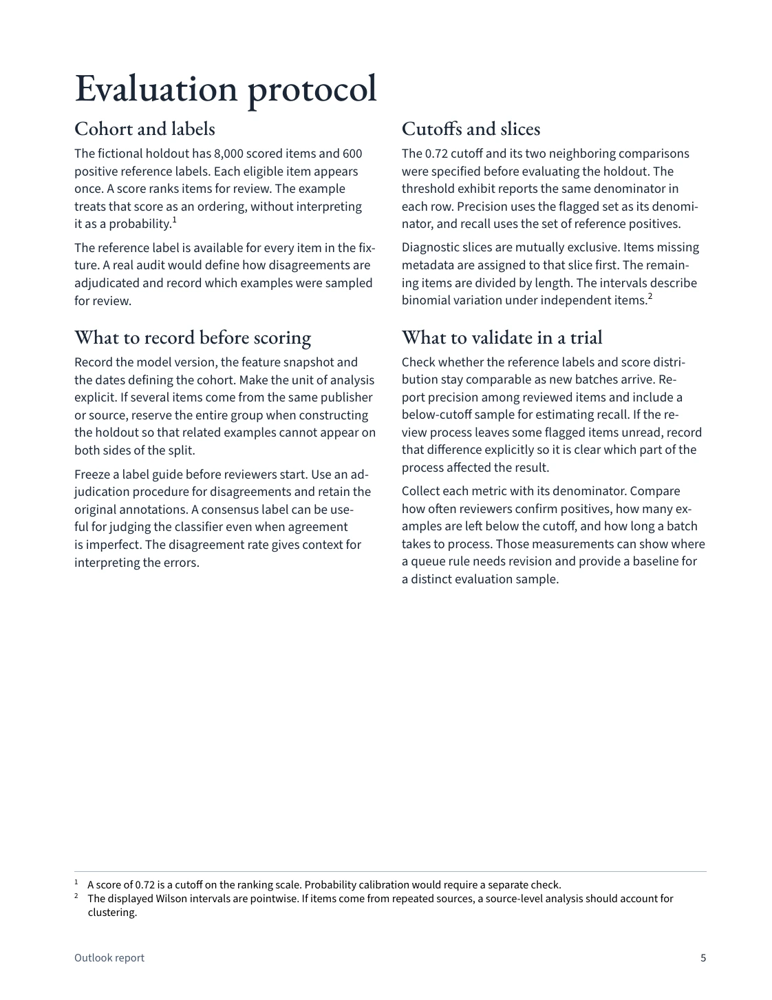
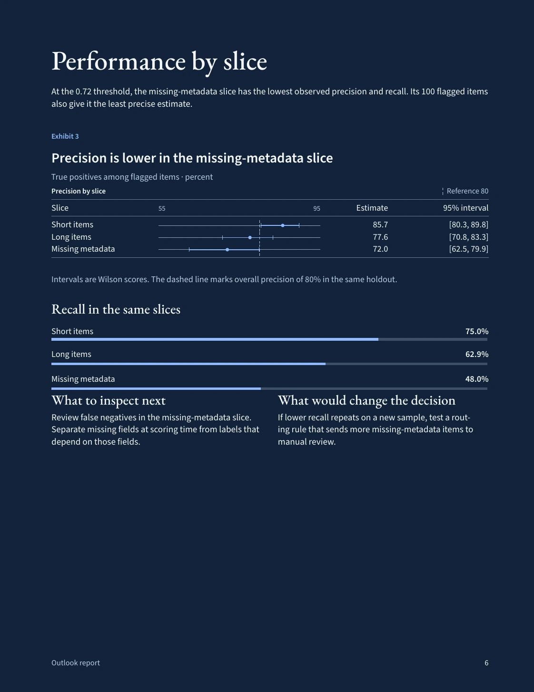

# Folio Reports

Write in Markdown and publish an editorial PDF with two-column prose, full-width evidence, and an optional illustrated cover. Each report includes its own editable LaTeX and build settings.

## Make a report

Install [Pandoc](https://pandoc.org/installing.html) and [Tectonic](https://tectonic-typesetting.github.io/). With Python 3.12 or newer and uv, install Folio from GitHub.

```sh
uv tool install git+https://github.com/EssenceSentry/folio-reports.git
folio-reports new model-review --title "Evaluation under a review budget" --author "Model Evaluation"
folio-reports build model-review
```

Write below the metadata in `model-review/report.md` and rebuild. Run `folio-reports new worked-example` to start from the complete sample. Tectonic downloads its TeX packages on the first build.

Use ordinary Markdown for prose, tables, figures, equations and citations. Add a metric rail, an exhibit or a dedicated data page when the evidence calls for it. To use your own cover art, put a portrait image beside the report and set `folio-cover-image` in the manuscript metadata. The title, subtitle, byline and date stay editable and selectable.

The [authoring guide](docs/getting-started.md) covers page composition and LaTeX export. The [component reference](docs/components.md) includes working markup. Folio's [typography skill](skills/typography/SKILL.md) helps you check the exported pages at reading size.

Projects created with earlier Folio releases can still build from their own files.

[Template source](src/folio_reports/templates/outlook/report.md) · [Development](DEVELOPMENT.md)

## Rendered pages

The worked example evaluates a synthetic classifier under a fixed review budget. Open an image to inspect the page at full size, or [read the complete PDF](examples/outlook-report.pdf).

| Illustrated cover | Two-column overview |
| --- | --- |
| [](examples/outlook-pages/page-1.webp) | [](examples/outlook-pages/page-2.webp) |

| Metric rail | Full-width exhibits |
| --- | --- |
| [](examples/outlook-pages/page-3.webp) | [](examples/outlook-pages/page-4.webp) |

| Methods and notes | Diagnostic page |
| --- | --- |
| [](examples/outlook-pages/page-5.webp) | [](examples/outlook-pages/page-6.webp) |
